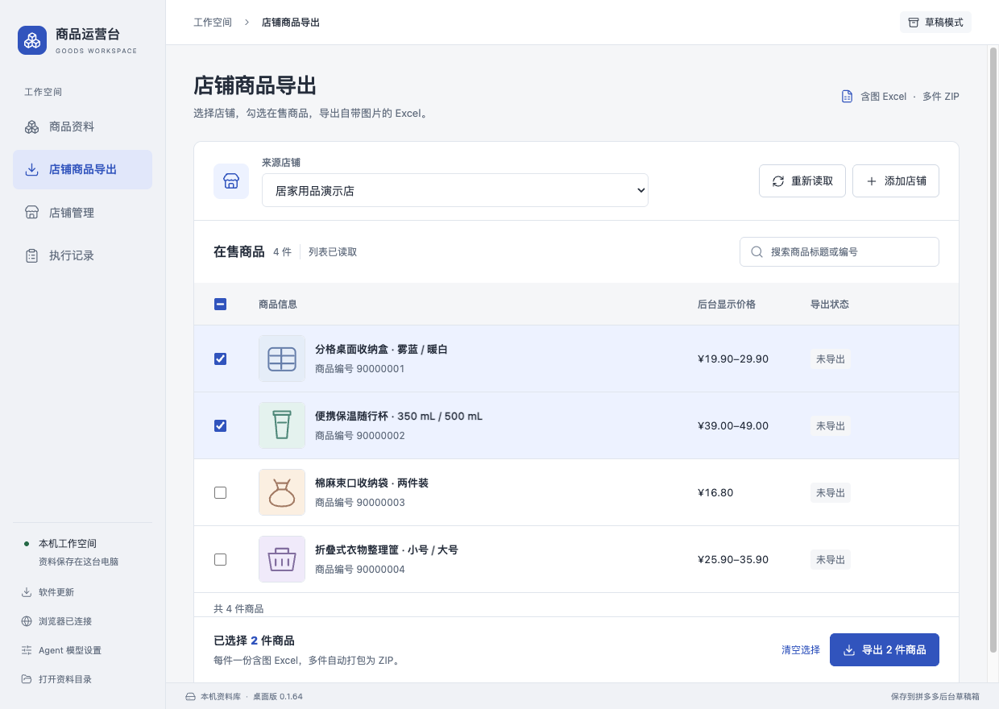

<p align="center">
  
</p>

<h1 align="center">拼多多批量上架助手</h1>

<p align="center">导入含图 Excel，核对商品和规格，批量保存拼多多后台草稿。</p>

<p align="center">
  <a href="https://github.com/XXm222/pdd-batch-listing/releases/latest"></a>
  <a href="https://github.com/XXm222/pdd-batch-listing/actions/workflows/ci.yml"></a>
  <a href="LICENSE"></a>
</p>

<p align="center">
  <a href="#下载安装"><strong>下载安装</strong></a> · <a href="#快速上手">快速上手</a> · <a href="#本地开发">本地开发</a> · <a href="项目文档/README.md">项目文档</a>
</p>

## 下载安装

| Windows x64 | macOS · Apple Silicon |
| --- | --- |
| [**下载 Setup**](https://www.mandla.cn/goods-updates/windows-x64.exe) | [**下载 DMG**](https://www.mandla.cn/goods-updates/mac-arm64.dmg) |

安装后在系统中打开 **商品运营台**。安装包自带运行时，后续可在应用左下角检查更新。macOS 安装包尚未完成 Apple Developer ID 签名与公证。详情和校验文件见 [GitHub Releases](https://github.com/XXm222/pdd-batch-listing/releases/latest)。

## 核心功能

| 功能 | 可以做什么 |
| --- | --- |
| **商品资料导入** | 一份 Excel 对应一件商品，可一次选择多份。支持普通内嵌图片和 WPS DISPIMG。 |
| **多规格编辑** | 按组合核对规格图、拼单价、单买价、库存和编码，集中整理轮播图、详情图与发货服务。 |
| **批量保存草稿** | 核对登录店铺后执行，保存后回读字段并核对草稿箱。进度、耗时与结果保存在本机。 |
| **店铺商品导出** | 搜索在售商品并跨页勾选，一次最多 50 件。单件导出含图 Excel，多件打包成 ZIP。 |

<p align="center">
  
  <br>
  <sub>店铺商品导出 · 演示数据</sub>
</p>

## 快速上手

1. **准备资料**。在 App 下载 Excel 模板，按需填写商品、规格与图片。 [模板](运营资料/商品资料模板.xlsx) · [填写示例](运营资料/商品资料示例.xlsx) · [资料规范](项目文档/05运营资料规范.md)
2. **导入并核对**。点击「上传 Excel」，核对基本资料、规格与价格、商品图片、发货与服务，再保存到本机。
3. **连接浏览器并选店**。从 App 左下角打开「浏览器连接 · 安装教程」，在 Chrome 或 Edge 中加载 Kimi 浏览器扩展，确认目标店铺已登录。使用本机资料功能时可跳过此步。
4. **保存草稿并查看结果**。选择商品和目标店铺，点击「开始填写并保存草稿」，在执行记录中核对结果。遇到验证码时按提示在浏览器中完成验证。

> 当前支持拼多多草稿业务。正式发布由运营在拼多多商家后台完成。

## 本地开发

**Electron · React · TypeScript · Vite · SQLite（sql.js）**

开发环境使用 Node.js `24.19.0` 和 pnpm `11.19.0`。

```bash
git clone https://github.com/XXm222/pdd-batch-listing.git
cd pdd-batch-listing
pnpm install --frozen-lockfile
node node_modules/electron/install.js
pnpm dev
```

`pnpm dev` 同时启动 Vite 和 Electron。可通过 `GOODS_WORKSPACE_DATA_DIR` 指定独立的测试资料目录。

```bash
pnpm format:check
pnpm typecheck
pnpm test
pnpm build
```

[技术架构](项目文档/02技术选型与架构.md) · [维护与发布](项目文档/33维护交接与更新发布.md) · [验收记录与历史版本](项目文档/README.md#版本与验证)

## 许可

项目源码公开，采用 **PolyForm Noncommercial 1.0.0**。用于经营店铺、公司业务或商业分发前，请取得权利人书面许可。第三方依赖与浏览器扩展适用各自许可。 [LICENSE](LICENSE) · [NOTICE](NOTICE) · [联系维护者](https://github.com/XXm222/pdd-batch-listing/issues/new)
